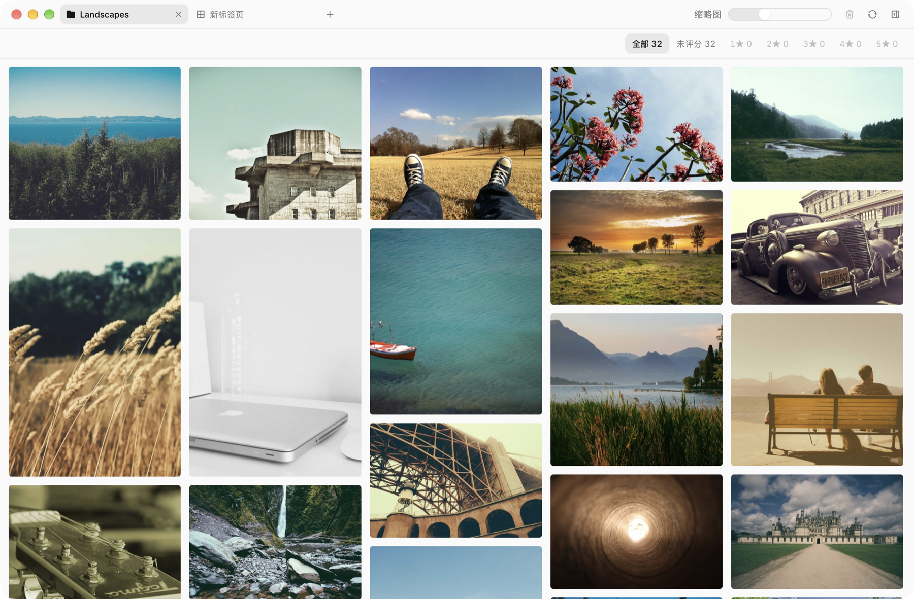

<div align="center">

# Picnest

**A fast, keyboard-friendly photo browser for macOS.**
**一款为 macOS 打造的快速、键盘友好的图片浏览器。**

[English](#english) · [简体中文](#简体中文)



</div>

---

## English

Picnest is a native-feeling **macOS** app for browsing and culling folders of photos. Point it at any folder on disk and it lays your pictures out in a masonry grid — no import step, no library to manage.

### Features

- **Folders, not libraries** — add any folder (or drag one onto the window); your files stay where they are.
- **Tabs** — open folders in tabs like a browser; close others or those to the right.
- **Browse subfolders in place** — step into nested folders and back via the breadcrumb.
- **Masonry grid** — adjustable thumbnail size, with a cached, prioritized thumbnail pipeline.
- **Lightbox preview** — press Space to preview, swipe between photos on the trackpad.
- **Rate & filter** — rate with `0`–`5` and filter the grid by stars.
- **Cull from the keyboard** — delete moves photos to the Trash, and `⌘Z` brings them back.
- **Info panel** — file details and metadata for the selected photo.
- **Live** — the grid follows changes made to the folder on disk.

### Keyboard shortcuts

| Key | Action |
| --- | --- |
| Arrow keys (`⇧` to extend) | Move selection |
| `Space` | Preview selection / close preview |
| `←` / `→` | Previous / next photo in preview |
| `0`–`5` | Rate selection |
| `Delete` / `⌫` | Move selection to Trash |
| `⌘Z` | Undo delete |
| `⌘A` | Select all |
| `⌘=` / `⌘-` / `⌘0` | Bigger / smaller / default thumbnails |
| `⌘T` / `⌘W` | New tab / close tab |

### Requirements

- macOS on Apple silicon (arm64)

### Build from source

Requires [Bun](https://bun.sh) and [Go](https://go.dev).

```sh
bun install
bun run dev     # run in development mode
bun run build   # build Picnest.app and a .dmg into apps/desktop/bin
```

---

## 简体中文

Picnest 是一款专为 **macOS** 打造的图片浏览与筛片工具。选中磁盘上任意文件夹，它就会把图片以瀑布流排开——无需导入，也不用维护图库。

### 功能

- **直接用文件夹** —— 添加任意文件夹（或直接拖进窗口），文件原地不动。
- **多标签页** —— 像浏览器一样用标签页打开文件夹，支持关闭其他 / 右侧标签页。
- **原地浏览子文件夹** —— 进入嵌套文件夹，通过路径栏随时返回。
- **瀑布流网格** —— 缩略图大小可调，缩略图带缓存与优先级调度。
- **大图预览** —— 按空格预览，触控板左右轻扫切换照片。
- **评分与筛选** —— 用 `0`–`5` 打星，按星级筛选。
- **键盘筛片** —— 删除的照片会移到废纸篓，`⌘Z` 即可撤销。
- **信息面板** —— 查看所选照片的文件信息与元数据。
- **实时同步** —— 磁盘上文件夹的变动会即时反映到网格中。

### 快捷键

| 按键 | 作用 |
| --- | --- |
| 方向键（按住 `⇧` 扩展选择） | 移动选择 |
| `空格` | 预览所选 / 关闭预览 |
| `←` / `→` | 预览中上一张 / 下一张 |
| `0`–`5` | 为所选评分 |
| `Delete` / `⌫` | 将所选移到废纸篓 |
| `⌘Z` | 撤销删除 |
| `⌘A` | 全选 |
| `⌘=` / `⌘-` / `⌘0` | 放大 / 缩小 / 恢复默认缩略图 |
| `⌘T` / `⌘W` | 新建标签页 / 关闭标签页 |

### 系统要求

- 搭载 Apple 芯片（arm64）的 macOS

### 从源码构建

需要安装 [Bun](https://bun.sh) 与 [Go](https://go.dev)。

```sh
bun install
bun run dev     # 开发模式运行
bun run build   # 构建 Picnest.app 和 .dmg，输出到 apps/desktop/bin
```
